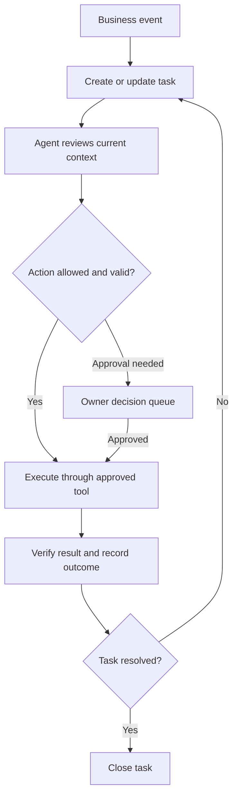

# Selestial: product brief and agent design

**Status: the owner's direction, recorded November 15, 2026.** This document is
the source of truth. If a build prompt and this document disagree, this
document wins until we change it on purpose.

The product is named **Selestial**. The repository and the Vercel project are
still named Renuvo, which was the working name.

Two references sit behind it:

- **Novara** (`novaracleaningui`) is the reference operation. It shows what a
  cleaning company actually needs, in working detail. We reuse its rules and
  ideas. We do not copy its code without choosing to, piece by piece.
- **Vistrial** is the reference for how the product is built: work done as
  checked steps instead of free-running AI, one approvals queue, permissions
  the owner sets per action, and a record behind every claim.

## Decisions on record

| Area | Decision |
|---|---|
| Name | Selestial. |
| Philosophy | Ownership of the outcome. |
| Agents | Eight, in three departments (decided later on November 15; see `01-navigation.md`). Growth: Marketing, Sales, Retention. Operations: Dispatch, Quality, Customer Care. Team: Recruiter, Team Coordinator. Sections 3 and 11 to 14 below describe the first four (Sales, Recruiter, Dispatch, Retention); the other four are named and not yet designed. |
| Departments | Growth, Operations, Team. They are departments, not lifecycle stages. |
| Navigation | `01-navigation.md` sets the sidebar, the route map and the interaction rules. |
| Workers | Contractors paid a share of the job, and hourly employees. Both at launch. |
| Channels | Text, email and web chat first. Voice follows. |
| Kinds of work | Homes, short-term rentals, property managers, offices and commercial. |
| Pricing of Selestial | A monthly plan that includes agent work and texting, with top-ups beyond that. |
| Stack | Next.js, Convex, Clerk, Vercel. A fresh build. |
| Build order | Shared foundation, Dispatch, Sales, Retention, Recruiter. |
| Public site | Light, brand teal `#2CC5A8`. One action: get early access. |

Section 19 lists what is still open, including two points where the latest
direction differs from an earlier answer.

---

## 1. Purpose and philosophy

**Purpose.** Give cleaning business owners the freedom to lead a company that
follows through.

**Philosophy.** Ownership of the outcome. Each agent takes responsibility for
moving work toward a clear result, follows through when circumstances change,
and brings the owner in when judgment is needed.

**Operating principles.** Clear commitments, dependable execution, earned
autonomy, and visible accountability.

**The belief behind it.** A cleaning business should grow without requiring
its owner to personally hold every part together.

**In one line.** The owner sets the standards. Selestial carries the work
forward.

**What that means for a cleaning company.** Fewer loose ends: inquiries
waiting for replies, applicants disappearing during onboarding, jobs without
confirmed cleaners, and customers quietly leaving.

**The reason an owner stays** is a feeling they can back up: "I know what is
happening, and I no longer have to chase everything myself." The agents have
to earn that through their behavior. A promise on a landing page does not.

## 2. What Selestial is

Selestial is one shared operating system for a cleaning company, with eight
agents working inside it. The owner configures how the company operates. The
agents handle the work they are permitted to do. Unresolved decisions arrive
in one approval queue.

**Who it is for.** Residential and light-commercial cleaning companies, from
an owner with three cleaners up to a multi-crew operation with office staff.

**Selestial is the system of record.** Customers, properties, jobs, cleaners,
money and conversations live here, because agents cannot run dispatch on
someone else's calendar. Import tools make switching easy.

## 3. Each agent's responsibility and standard for completion

Every agent has a responsibility and a standard for when its work is done.

| Agent | Guiding belief | What completion means |
|---|---|---|
| **Sales** | Every inquiry deserves a timely, honest path to a decision. | A suitable booking the company can fulfill, a clear decline, or a documented next step. |
| **Recruiter** | Growth requires dependable people and clear expectations. | An owner-approved cleaner ready for appropriate work, with availability and onboarding requirements confirmed. |
| **Dispatch** | A booking is a promise to both the customer and the cleaner. | An accepted assignment, communicated expectations, and verified service status, with exceptions resolved or escalated. |
| **Retention** | Repeat business is earned through consistent care. | Feedback addressed, service issues followed through, and an appropriate next service agreed upon. |

This prevents shallow measures of success:

- Sales does not count a booking Dispatch cannot cover.
- Recruiter does not count applications that never become ready cleaners.
- Retention does not push another booking while a complaint is unresolved.

## 4. Five principles that govern the platform

1. **Follow through until the work reaches a clear state.** Sending a message
   is an action. Getting an answer, arranging the next step, or escalating an
   unresolved issue is progress. Every open task needs an owner, a next
   action, and a deadline.
2. **Make promises the business can keep.** Agents work within actual
   capacity, pricing rules, service areas and customer expectations. If
   information is missing, they resolve the uncertainty before committing.
3. **Treat reliability as part of growth.** Filling the calendar only helps
   when the company can deliver well. Sales and Recruiter respond to capacity.
   Dispatch and Retention feed service problems back into future decisions.
4. **Earn autonomy through demonstrated reliability.** Owners begin with
   review and approval, then delegate specific actions as confidence grows.
   Permissions are granular: permission to send a reminder does not grant
   permission to discount a service or change an assignment.
5. **Make every action explainable.** The owner can see what happened, why the
   agent acted, what the result was, and what remains unresolved. "Handled"
   must mean something that can be checked.

## 5. Respect for cleaners

Respect for cleaners is part of the philosophy and part of the operating
logic. Availability, realistic travel time, clear job scope and explicit
acceptance of each assignment are enforced by the system. A platform that
treats cleaners as interchangeable calendar slots undermines its own
reliability.

In practice:

- A cleaner is never booked into a time they have not said they can work.
- Travel and time between jobs are counted before an offer is made.
- An offer states the scope and that cleaner's own pay.
- An assignment is confirmed only when the cleaner accepts it.
- An agent never changes a cleaner's pay and never penalizes a cleaner.

## 6. What AI does and what code does

AI interprets messages, identifies missing information, explains choices and
proposes appropriate actions.

Ordinary application code enforces:

- prices and discount limits;
- availability and scheduling conflicts;
- required qualifications;
- permissions and approval thresholds;
- payment operations;
- allowed status changes.

For example, Sales may interpret "three bedrooms, two baths, and a very dirty
oven." A pricing function calculates the quote from those inputs. The agent
can explain the quote. It cannot invent a discount.

Rules that follow from this, for every agent:

- **Skills are checked steps.** Read the record, compute in code, let the
  model write or classify where language is needed, check the result in code,
  then act or ask. The model does not free-run.
- **The model never produces a number.** Prices, pay, scores, distances, fees
  and dates come from code and settings.
- **Outside text is data, never instructions.** A customer's message, an
  applicant's answer or a web page cannot change what an agent may do.
- **Agents say they are AI.** No human personas. An agent introduces itself as
  the company's assistant and gives a straight answer if asked.
- **Honest screens.** If a connection or setting is missing, the screen says
  "not set up yet". It never shows a made-up number.
- **One send gate.** Consent, opt-out, quiet hours and how often a person has
  already been contacted are checked at send time, every time, in one place
  that every agent goes through.

### Tools

Each agent gets a small set of tools. Each tool checks permissions and the
current state of the business before it runs. An agent proposing an action is
never enough authorization by itself.

| Agent | Example tools |
|---|---|
| Sales | `calculate_quote`, `check_capacity`, `send_quote`, `request_booking` |
| Recruiter | `request_applicant_details`, `schedule_interview`, `submit_candidate_for_review` |
| Dispatch | `find_eligible_cleaners`, `offer_assignment`, `confirm_assignment`, `escalate_coverage_gap` |
| Retention | `request_feedback`, `open_service_issue`, `offer_recurring_plan`, `request_service_recovery` |

## 7. Authority

The owner sets, for each kind of action, what each agent may execute, propose
or escalate.

| Permission | What happens |
|---|---|
| **Off** | The agent does not do this. |
| **Propose** | The agent prepares the action and its reason. A person approves, changes or skips it. |
| **Execute and report** | The agent acts and tells the owner each time. Undo is offered where undo is possible. |
| **Execute** | The agent acts. It appears in the action history. |

When an action is outside what the agent is allowed, it **escalates**: the
task goes to a person with the context and the open question.

Rules around the permissions:

- **Every company starts with review.** New companies begin on Propose for
  anything a customer, cleaner or applicant will see.
- **A track record is shown before loosening.** For example: "Dispatch
  requested 41 acceptances this week. You changed 2."
- **It steps back down.** If one kind of action is undone or rejected often,
  that action returns to Propose on its own and the owner is told.
- **Money has limits.** Money actions carry an owner-set ceiling per action
  and per day.
- **Reassigning a confirmed visit needs the owner at first.** This loosens
  only after the workflow has proved dependable.
- **Some things always need a person**, at any setting:
  - rejecting or ending a worker on the model's judgment;
  - any decision that follows a background check;
  - paying out a pay run;
  - refunds, credits or compensation above the owner's limit;
  - changing prices, pay rates or policies;
  - anything legal, an injury, property damage or a payment dispute.
- **The owner can step in.** Take over a conversation, change a decision, or
  pause one agent or all of them.

## 8. Onboarding sets the company's operating rules

Before any agent acts, Selestial needs the company's rules.

| Area | The owner configures |
|---|---|
| Services | Cleaning types, inclusions, exclusions, add-ons, estimated duration |
| Pricing | Pricing method, minimum charge, recurring discounts, approval thresholds |
| Coverage | Service areas, operating hours, travel buffers |
| Workforce | Cleaners, teams, skills, availability, assignment acceptance requirements |
| Customer policies | Cancellations, rescheduling, complaints, refunds |
| Authority | What each agent may execute, propose or escalate |

These are saved as structured settings. A written description of the business
can add context, but pricing and scheduling rules need explicit values the
system can enforce.

Novara shows how deep these rules go for one company. Selestial makes each of
them a setting.

## 9. The shared record

All agents read and write the same business records. No agent keeps
private data.

- **Customers and properties.** Contacts, service history, access
  instructions, preferences. A customer can have several properties.
- **Opportunities and quotes.** Requirements, price with a reason for each
  line, stage, next follow-up.
- **Cleaners and applicants.** Qualifications, availability, onboarding
  status, documents and expiries.
- **Jobs and assignments.** Service scope, time window, assigned team,
  acceptance, completion.
- **Recurring plans.** Cadence, billing, service preferences.
- **Conversations, tasks, approvals and outcomes.** What was communicated,
  attempted, decided and completed.
- **Money.** Charges, refunds, credits, tips, pay lines and payouts, as one
  ledger.
- **Events.** An append-only log of everything that happens.

**Jobs, assignments and payments are separate.** A customer paying does not
establish that a cleaner has accepted the work. A recurring plan becoming
active does not establish that future visits have coverage. Each has its own
status and none is inferred from another.

Lessons taken from Novara: one status list per thing, customers and
properties as real linked records, and one ledger for money.

## 10. Events start the work, tasks carry it

Agents react to events: an inquiry arrives, a quote goes unanswered, a
cleaner declines, a visit is completed.

Every task has:

- a responsible agent;
- a next action;
- a deadline;
- a completion condition.

Waiting on a customer or a cleaner is an explicit state with a follow-up
time. Nothing sits in "sent" and is forgotten.

Agents coordinate through tasks and the shared record, never privately. When
Dispatch cannot cover recurring work, it creates a staffing-gap task for
Recruiter. The owner can trace what was asked and what happened.

Background work runs as durable queued tasks with retries, response deadlines
and protection against doing the same action twice. A page request is never
responsible for keeping a multi-day workflow alive.

## 11. Dispatch

**Belief.** A booking is a promise to both the customer and the cleaner.

**Completion.** Service completed, cancelled, or handed to the owner with a
clear unresolved issue.

**First workflow.** Review upcoming jobs, identify eligible cleaners, request
acceptance, confirm coverage, monitor exceptions.

Dispatch is the first agent built. A visit is not treated as operationally
confirmed until an availability and assignment layer says so.

### The assignment method

1. **Filter** cleaners by availability, service area, required skills and
   scheduling conflicts.
2. **Rank** the eligible ones by customer preference, continuity, travel and
   workload.
3. **Request acceptance** with a response deadline. The offer states the
   scope and that cleaner's pay.
4. **Confirm** after acceptance. Try the next eligible cleaner if the offer is
   declined or expires.
5. **Escalate** when coverage cannot be secured within the owner's rules.

### After the assignment

- **Confirm.** The day before, confirm with crew and customer.
- **Watch the day.** No check-in near the start time: ask the cleaner, then
  alert, then treat it as a no-show and start cover. If a cleaner is running
  late, work out which later visits are affected and tell those customers.
- **Cover.** When a cleaner drops out, offer the visit to eligible
  replacements one at a time, with a short window each.
- **Verify.** When the crew marks a visit complete, check the evidence:
  checklist done, required photos present, time on site reasonable. Clean
  evidence closes the visit. Weak evidence goes to a person with the reason.
- **Report capacity.** Open hours and gaps by area and day go to Sales and
  Recruiter.

### Default permissions

| Action | Default |
|---|---|
| Request acceptance, re-offer, reminders, confirmations | Propose at first, then Execute |
| Tell a customer a visit is running late | Execute and report |
| Close a visit on clean evidence | Execute and report |
| Reassign a confirmed visit | Propose |
| Override the time-between-jobs rule | Propose |
| Any consequence for a cleaner | A person, always |

### From Novara

The scoring rules. The time-between-jobs guard. The offer, accept and expiry
flow. The late, no-show and cover ladder. The crew pay calculation with a pay
snapshot at offer and a lock at completion. The checklist engine with a
snapshot per job. The re-clean policy.

**What we add:** real drive times, a cleaner availability calendar the main
matcher respects, location check-in, and checking photos and checklists
before a visit is closed.

## 12. Sales

**Belief.** Every inquiry deserves a timely, honest path to a decision.

**Completion.** Confirmed booking, declined opportunity, or explicit handoff
to a person.

**First workflow.** Receive inquiry, collect missing details, calculate
quote, check capacity, follow up, arrange booking.

### How it works

1. **Reply fast**, on the channel the person used.
2. **Collect what the price needs**: service area, home size, condition,
   service type, timing. Nothing more.
3. **Quote** by calling the pricing rules. Speak only that price. Save every
   quote with its inputs and hold it for a set time.
4. **Check capacity** with Dispatch before offering a time.
5. **Arrange the booking** with a secure payment link. Never take a card
   number in conversation.
6. **Follow up** on a set cadence until booked, declined or opted out. Stop
   the moment a person on the team takes over the thread.

Sales never quotes a price the rules did not produce, and never promises a
discount the checkout will not honor.

### Default permissions

| Action | Default |
|---|---|
| Reply, collect details, send a quote from the rules | Propose at first, then Execute |
| Follow-up messages | Execute |
| Discount inside the owner's allowed band | Execute and report |
| Discount outside the band, custom or commercial price | Propose |
| Damage, a dispute or a legal question | Escalate |

### From Novara

The layered pricing engine with a floor, a ceiling and explained lines. Quote
hold and override rules. The speed-to-lead timer. The conversation tools (look
up customer, check area, price, open times, create booking, hand to a
person). The reminder cadences. Self-serve quotes for short-term-rental hosts
and property managers.

**What we fix:** Novara has four pricing sources that disagree. Selestial has
one. Every channel and every staff member gets the same price for the same
home.

## 13. Retention

**Belief.** Repeat business is earned through consistent care.

**Completion.** Follow-up resolved with a documented customer outcome.

**First workflow.** Review completed service, collect feedback, address
concerns, propose recurring service or appropriate recovery.

### How it works

1. **After every visit**, ask how it went. Everyone is invited to leave a
   public review. Anyone unhappy also gets a service issue opened at once.
2. **Address concerns first.** Gather the facts and the visit's evidence,
   apply the company's guarantee rules, and propose a remedy: a re-clean, a
   credit or a refund. No offer of more service goes out while an issue is
   open.
3. **Propose recurring service** after a good visit, at the company's plan
   price.
4. **Care for the plan.** Create upcoming visits ahead of time, keep the
   customer's usual cleaner where possible, and let the customer skip, move,
   pause or cancel from a link.
5. **Recover failed payments** with a card-update link and a retry schedule.
6. **Handle a cancel request** honestly: ask why, offer the options the owner
   allows, and if the customer still wants to cancel, end the billing and the
   visits in one step.
7. **Reconnect** with customers who have gone quiet, around their expected
   rebooking date.

Retention never filters who is asked for a public review, never makes it hard
to cancel, and never charges a card it was told to stop charging.

### Default permissions

| Action | Default |
|---|---|
| Request feedback, invite a review, reminders | Execute |
| Offer a recurring plan at the standard price | Propose at first, then Execute |
| Payment recovery messages and retries | Execute |
| Re-clean or credit inside the owner's limit | Execute and report |
| Refund or compensation above the limit | Propose |
| Cancel on request | Execute |
| Payment dispute or damage claim | Escalate |

### From Novara and the earlier Renuvo build

The email rules engine (consent, suppression, footers, delivery log). The
recurring visit generator. The manage-my-plan link pages. The feedback and tip
flows. The credit ledger. The re-clean classification. From the earlier Renuvo
build: the guarded send path, win-back, cancel handling and the customer
portal, as a reference for behavior.

**What we fix:** Novara sends only happy customers to public review; Selestial
invites everyone. Novara's link-page cancel stops visits but not billing;
Selestial's does both. Novara has no failed-payment recovery in code; it is
core here.

## 14. Recruiter

**Belief.** Growth requires dependable people and clear expectations.

**Completion.** An owner-approved cleaner meets the readiness requirements.

**First workflow.** Receive application, check owner-defined requirements,
collect missing information, coordinate interview, track onboarding.

### How it works

1. **Know the need.** Read Dispatch's staffing-gap tasks and turn them into a
   recruiting priority by area and day.
2. **Check requirements.** The owner publishes fixed requirements. These are
   yes-or-no checks in code. An applicant who misses one is told plainly.
3. **Collect what is missing**, and keep the applicant moving.
4. **Coordinate the interview**, structured against the company's scorecard,
   with each answer kept beside its score.
5. **Submit candidates for review.** A person decides who moves forward.
6. **Track onboarding** through the company's steps: agreement, identity, tax
   form, payout method, supplies, training. Chase what is stale and report who
   is stuck and where.
7. **Hand over** a ready cleaner to Dispatch, with availability confirmed.

Recruiter never rejects a person on the model's judgment, never makes or
implies a decision from a background check, and never uses protected
characteristics in any step.

### Default permissions

| Action | Default |
|---|---|
| Acknowledge, answer questions, request missing details, reminders | Execute |
| Decline on a published fixed requirement | Execute and report |
| Coordinate and run the interview | Propose at first, then Execute |
| Move a candidate forward, mark a cleaner ready | Propose |
| Reject after interview, end an engagement | A person, always |
| Any step after a background check | A person, always |

### From Novara

The application rules engine. The save-and-resume application. The
phone-screen script and scorecard, which becomes the interview. The versioned
consent record. The onboarding step list with a first-job readiness check. The
in-app training tours. The tax forms.

**What we add:** a link to dispatch demand, a background-check provider
(Novara's policy names one but none is connected), interview scheduling, and
more than one source of applicants.

**A legal note.** Hiring is the most regulated area an agent touches. Rules on
automated hiring decisions and on background checks differ by state. Legal
review is needed before this agent is sold.

## 15. One change reaches everyone it affects

A cleaner cancels tomorrow. The response should reach every part of the
business it touches.

| Agent | What it does |
|---|---|
| Dispatch | Works on coverage: checks eligible replacements, requests acceptance, and flags the job if coverage remains unresolved. |
| Sales | Works with updated availability, so new bookings reflect the capacity the company can actually offer. |
| Retention | Keeps the customer's history in view, so previous service issues inform whether the customer needs extra attention. |
| Recruiter | Sees recurring staffing gaps, so persistent shortages become a clear recruiting priority. |

The owner can see what happened, what is being handled, and where a decision
is needed.

One conversation thread per person is shared by every agent, and the send
gate stops two agents messaging the same person about different things on one
afternoon.

## 16. The owner's home screen

The defining experience is a business that arrives with answers.

| Section | What it answers |
|---|---|
| Today's service | Which jobs are confirmed, underway, completed or at risk? |
| Needs your decision | What requires approval, and by when? |
| Agents working | What is progressing or waiting on a response? |
| Results | What was booked, covered, recovered or left unresolved? |

Illustrative lines, to show the behavior the philosophy should produce:

- **Resolved:** Tomorrow's uncovered visit now has an accepted replacement.
- **In progress:** Three qualified inquiries are awaiting customer responses;
  follow-ups are scheduled.
- **Needs your decision:** A customer requested compensation beyond your
  authorized limit.
- **Capacity concern:** Upcoming recurring work exceeds confirmed cleaner
  availability; recruiting needs attention.

Each item opens the underlying job, conversation, reasoning and action
history. Agent chat is available for instructions, but the operating records
are the source of truth.

**Checking the agents.** What an agent reports is shown beside what the record
confirms: bookings against payments received, assignments against check-ins,
kept customers against plans still active a month later. A source that cannot
be reached reads "unverified", never zero.

**Other people.** Cleaners get a phone-first view: offers, today's jobs,
checklist, photos, pay. Customers get link pages that need no login.
Applicants get the application and onboarding steps.

**Roles inside a company.** Owner (everything), Manager (operations and
approvals, no billing or authority settings), Office (work the queue and
conversations). Selestial staff sit outside every company and enter only
through a separate, logged path.

## 17. Planned later

**Superseded in part.** Quality and Marketing are now two of the eight agents
(`01-navigation.md`). Books is an open question (section 19).

Three more agents are planned on the same record. None is built.

- **Quality.** Checklists, inspections, service issues and coaching.
- **Books.** Invoices, pay runs, tax forms and the profit view.
- **Marketing.** Ads, reviews, referrals and local search, feeding Sales.

Each can be split out later without a rewrite, because agents share one
record and own workflows, not data.

## 18. Stack, build pattern and order of work

**Stack.** Next.js, Convex as the system of record and job runner, Clerk for
sign-in, Vercel. Each capability goes brief, data shapes, functions, workflow,
screen, tests, screenshots. Every function is registered through access
wrappers, and a test fails the build if one is not. A company's data returns
"not found" to anyone outside it.

**New for Selestial, not present in Vistrial:**

1. Owned texting, in and out, with carrier registration per company.
2. Agent work started by events, with a system actor.
3. Tasks with an owner, a next action, a deadline and a completion condition.
4. Granular permissions per action (section 7).
5. Fast replies: a conversation path that answers in seconds.
6. Users who are not staff: cleaners, customers, applicants.
7. Payments: customer charges and cleaner payouts per company.
8. A phone-first field experience.

**Start carrier registration for texting on day one.** It takes the longest
and nothing else can speed it up.

**Order of work.** Build the first complete journey before expanding.

1. **Shared foundation.** Properties, cleaners, availability, assignments,
   tasks, permissions and approvals.
2. **Dispatch.** Take an existing job through accepted assignment and
   completion.
3. **Sales.** Take a new inquiry through a quote and a booking backed by
   capacity.
4. **Retention.** Connect follow-up, recurring plans and recovery to verified
   service outcomes.
5. **Recruiter.** Turn applicants into approved, ready cleaners who become
   eligible for dispatch.

**The readiness test.** The first release is ready for a controlled pilot
when:

- one customer can move from inquiry, to completed clean, to recurring
  service; and
- a cleaner declining midway produces a recoverable task instead of a broken
  booking.

The exception is tested alongside the successful journey. That is the
behavior the philosophy has to produce.

## 19. Still open

1. **The pilot company.** The latest direction names a controlled Novara
   pilot. An earlier answer said Novara is a reference only and keeps its own
   system. To confirm: is Novara the pilot?
2. **The earlier Renuvo code.** The latest direction says to keep its
   customers, billing, messaging, recurring plans and event history. That
   code was removed from this repository on the owner's instruction and the
   build is on Convex, so this brief treats it as a reference to re-express,
   not code to run. To confirm.
3. **Where early-access requests are sent.** Settled: they are saved in
   Convex. The form opens once the deployment and its shared secret are set.
4. **The domain** is selestial.io. Still open: connecting it, and the legal
   name and contact address for the footer and legal pages.
5. **Brand color.** Teal was chosen under the Renuvo name. To confirm for
   Selestial.
6. **Legal review** of the Recruiter agent before it is sold.
7. **The price** of the monthly plan.
8. **Books.** Section 17 planned a Books agent. It is not among the eight
   agents in `01-navigation.md`, where Finance is a shared area. To confirm:
   is Books dropped, or does it come later?
